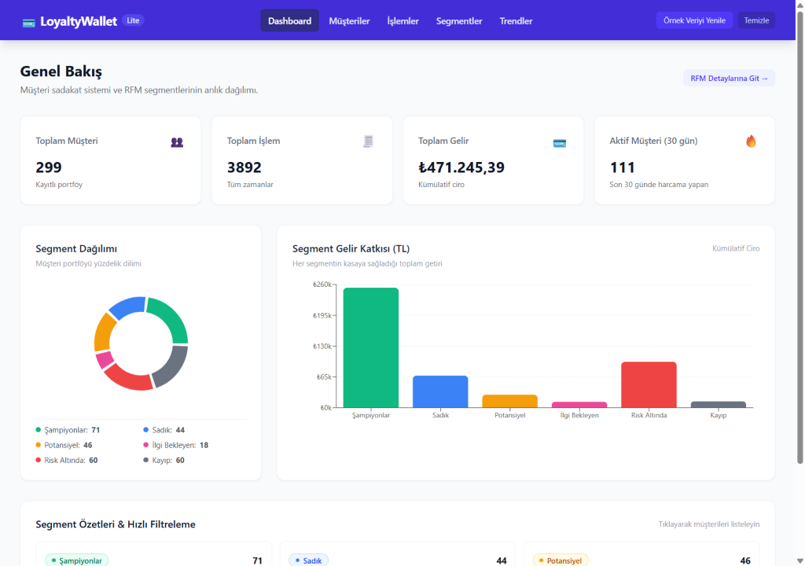
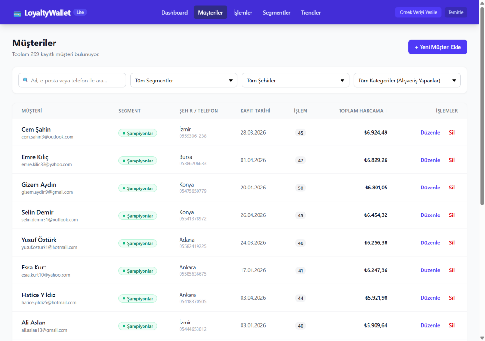
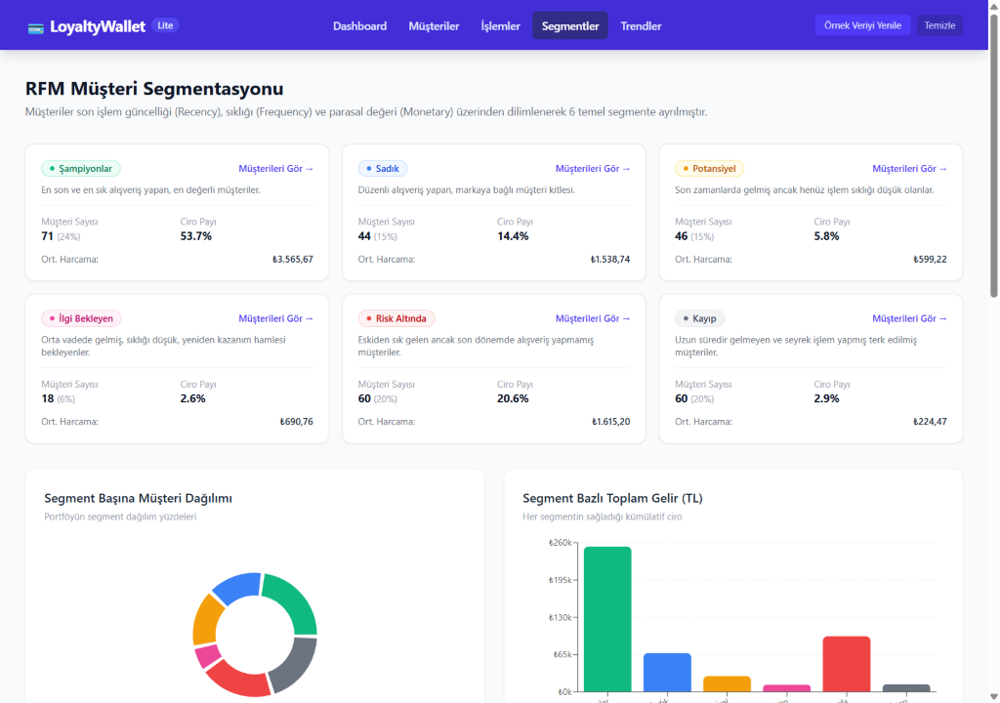
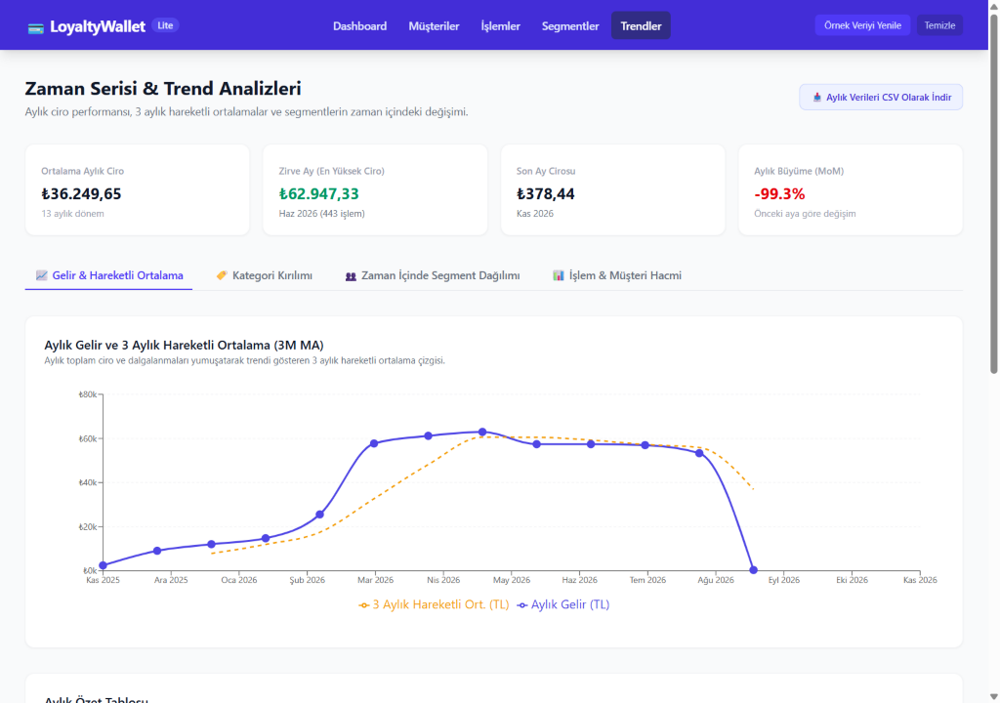

# LoyaltyWallet Lite 💳

> Müşteri sadakat sisteminin, percentile tabanlı RFM segmentasyonunun ve zaman serisi gelir analizlerinin istemci tarafında (frontend-only) çalışan modern web uygulaması.

[](#)
[](#)
[](#)
[](#)
[](#)

---

## 🌟 Proje Özeti

**LoyaltyWallet Lite**, işletmelerin müşteri portföylerini ve harcama işlemlerini yönetmesini, müşterileri **yüzdelik dilim (percentile) tabanlı RFM modeli** ile 6 stratejik segmente ayırmasını ve zaman serisi trend analizleriyle (aylık ciro, 3 aylık hareketli ortalama, kategori kırılımı, segment dinamikleri) gelir performansını izlemesini sağlayan frontend web uygulamasıdır.

Tüm veriler tamamen tarayıcı üzerinde (`LocalStorage`) tutulur; herhangi bir backend, harici veritabanı veya üçüncü parti API bağımlılığı bulunmaz.

---

## 🚀 Canlı Demo

* **Canlı Yayın (Netlify):** [https://loyaltywallet-lite.netlify.app](https://loyaltywallet-lite.netlify.app) *(Deploy sonrası aktif bağlantı)*
* **Kaynak Kod (GitHub):** [https://github.com/](https://github.com/)

---

## 📸 Ekran Görüntüleri

### 1. Genel Bakış (Dashboard)
Özet KPI kartları (Müşteri, İşlem, Ciro, Aktif Müşteri), segment pasta dağılımı ve segment gelir katkısı grafikleri.


### 2. Müşteri Yönetimi (Customers)
Arama, şehir ve segment filtreleri, dinamik sıralama, sayfalama ve ilişkisel silme korumalı müşteri CRUD tablosu.


### 3. RFM Segmentasyon Analizi (Segments)
6 stratejik segment kartı, ciro payları, Recharts pasta & çubuk grafikleri ve detaylı $R, F, M$ skor tablosu.


### 4. Zaman Serisi & Trendler (Trends)
Aylık ciro ve 3 aylık hareketli ortalama ($MA$) çizgisi, kategori kırılımlı yığılmış çubuk grafik, zaman içinde segment hacmi ve CSV dışa aktarımı.


---

## ✨ Temel Özellikler

- **Müşteri & İşlem Yönetimi (Tam CRUD):**
  - Form doğrulama (Ad-soyad zorunlu, regex e-posta formatı, pozitif tutar).
  - İlişkisel silme güvencesi (Bir müşteri silindiğinde o müşteriye ait tüm işlemler otomatik silinir ve kullanıcı önceden bilgilendirilir).
  - Çok kriterli filtreleme: Ad/e-posta/telefon araması, şehir, kategori, segment, tarih aralığı, min-maks tutar.
- **Percentile Tabanlı RFM Segmentasyonu:**
  - $p = \frac{\text{küçük} + 0.5 \times \text{eşit}}{n}$ formülüyle adil yüzdelik dilimleme.
  - Recency ters çevrimi ($R = 6 - \text{score}$).
  - Müşterileri 6 gruba ayırma: *Şampiyonlar, Sadık, Potansiyel, İlgi Bekleyen, Risk Altında, Kayıp*.
- **Zaman Serisi & Trend Analizleri:**
  - Aylık ciro toplama ve 3 aylık hareketli ortalama ($3M\ MA$).
  - Kategoriye göre yığılmış (Stacked) gelir çubuk grafiği.
  - Zaman içinde kümülatif segment dağılımı (Stacked Area chart).
  - Aylık metriklerin UTF-8 BOM destekli CSV olarak dışa aktarımı.
- **İsteğe Bağlı Örnek Veri Seti (On-Demand Seed):**
  - Deterministik PRNG (`mulberry32`) ile 300 müşteri ve ~3.900 gerçekçi işlem.
  - İster sıfır veriyle başlama, ister tek tıkla örnek veri yükleme veya temizleme.
  - Terminalden `npm run seed` ile bağımsız JSON çıktısı üretme.

---

## 📐 RFM Yöntemi ve Segment Kuralları

RFM analizi, müşterilerin son 365 gün içindeki davranışlarını değerlendirir:
- **Recency ($R$):** Referans tarihten bu yana geçen gün sayısı (az gün = yüksek puan).
- **Frequency ($F$):** Pencere içindeki toplam işlem sayısı (çok işlem = yüksek puan).
- **Monetary ($M$):** Pencere içindeki toplam harcama tutarı.

| Segment | Türkçe Karşılığı | Kural | Açıklama |
|---|---|---|---|
| **Champions** | Şampiyonlar | $R \ge 4$ ve $F \ge 4$ | En yakın zamanda ve en sık gelen, en değerli kitle |
| **Loyal** | Sadık | $R \ge 3$ ve $F \ge 3$ | Düzenli alışveriş yapan, bağlı kitle |
| **Potential** | Potansiyel | $R \ge 4$ ve $F \le 2$ | Yakın zamanda gelmiş ancak henüz işlem sıklığı düşük olanlar |
| **NeedAttention** | İlgi Bekleyen | $R = 3$ ve $F \le 2$ | Orta vadede gelmiş, yeniden kazanım hamlesi gerekenler |
| **AtRisk** | Risk Altında | $R \le 2$ ve $F \ge 3$ | Eskiden sık gelen ancak son dönemde uzaklaşmış müşteriler |
| **Lost** | Kayıp | $R \le 2$ ve $F \le 2$ | Uzun süredir gelmeyen ve seyrek işlem yapmış terk edilmiş kitle |

---

## 🛠️ Kullanılan Teknolojiler

| Alan | Teknoloji | Amaç |
|---|---|---|
| **Çatı / Kütüphane** | React 19 + TypeScript | Strict modda tip güvenli modern UI mimarisi |
| **Build Aracı** | Vite 8 | Ultra hızlı HMR ve optimize üretim derlemesi |
| **Stil Çözümü** | Tailwind CSS v4 (`@tailwindcss/vite`) | Modern, responsive ve utility-first tasarım |
| **Yönlendirme** | React Router DOM v7 | SPA istemci tarafı yönlendirmesi |
| **Grafikler** | Recharts v3 | Donut, Bar, Stacked Bar, Line ve Area grafikleri |
| **State Yönetimi** | React Context + `useReducer` | Global durum ve tek yönlü veri akışı |
| **Kalıcılık** | HTML5 LocalStorage | `lwl:` ön ekiyle hata toleranslı veri saklama |
| **Test** | Vitest | Saf hesaplama fonksiyonları (`rfm.ts`, `timeseries.ts`) için birim testleri |

---

## 📂 Klasör Yapısı

```
loyaltywallet-web/
├── docs/
│   └── screenshots/              # README ekran görüntüleri (.png)
├── public/
│   └── _redirects                # Netlify SPA yönlendirmesi (/* /index.html 200)
├── scripts/
│   ├── check-consistency.ts     # Veri tutarlılığı denetim scripti
│   └── seed-cli.ts               # Bağımsız CLI seed veri üretici
├── src/
│   ├── components/               # Ortak ve tekrar kullanılabilir bileşenler
│   │   ├── ConfirmDialog.tsx     # Silme onay modalı
│   │   ├── CustomerForm.tsx      # Müşteri ekleme/düzenleme formu
│   │   ├── Modal.tsx             # Genel modal pencere
│   │   ├── Navbar.tsx            # Üst navigasyon ve veri sıfırlama butonları
│   │   ├── SegmentBadge.tsx      # Renkli segment rozeti
│   │   ├── StatCard.tsx          # Özet metrik kartı
│   │   └── TransactionForm.tsx   # İşlem ekleme/düzenleme formu
│   ├── context/
│   │   ├── LoyaltyContext.tsx    # State reducer ve provider
│   │   └── loyaltyContextDef.ts  # Context arayüz ve tip tanımları
│   ├── hooks/
│   │   └── useLoyalty.ts         # Fast-refresh uyumlu özel Context hook'u
│   ├── interfaces/               # TypeScript veri modelleri
│   │   ├── Category.ts
│   │   ├── Customer.ts
│   │   ├── Rfm.ts
│   │   └── Transaction.ts
│   ├── pages/                    # Uygulama sayfaları
│   │   ├── Customers.tsx         # Müşteri CRUD + filtreleme + sayfalama
│   │   ├── Dashboard.tsx         # Özet kartlar + segment pasta/çubuk grafikler
│   │   ├── Segments.tsx          # RFM segment kartları + detay tablosu
│   │   ├── Transactions.tsx      # İşlem CRUD + çoklu filtreleme + sayfalama
│   │   └── Trends.tsx            # Zaman serisi grafikleri + CSV indirme
│   ├── services/
│   │   └── storage.ts            # LocalStorage tek erişim katmanı
│   ├── utils/
│   │   ├── format.ts             # Para ve tarih biçimlendirme
│   │   ├── rfm.ts                # Percentile, skorlama ve segment atama fonksiyonları
│   │   ├── seed.ts               # Deterministik sentetik veri üretici
│   │   └── timeseries.ts         # Aylık toplama, 3M hareketli ortalama, segment zaman serisi
│   ├── App.tsx                   # Ana uygulama ve sayfa yönlendirmeleri
│   ├── index.css                 # Tailwind CSS yönergeleri
│   └── main.tsx                  # Uygulama başlangıç noktası
├── netlify.toml                  # Netlify dağıtım yapılandırması
├── package.json                  # Proje bağımlılıkları ve scriptler
├── tsconfig.json                 # TypeScript yapılandırması
└── vite.config.ts                # Vite eklentileri (React + Tailwind)
```

---

## 💻 Kurulum ve Çalıştırma

Projeyi yerel ortamınızda çalıştırmak için aşağıdaki adımları izleyin:

```bash
# 1. Depoyu klonlayın
git clone https://github.com/<kullanici-adi>/loyaltywallet-web.git
cd loyaltywallet-web

# 2. Bağımlılıkları yükleyin
npm install

# 3. Geliştirme sunucusunu başlatın
npm run dev

# 4. Birim testlerini çalıştırın
npm test

# 5. Linter denetimini çalıştırın
npm run lint

# 6. Üretim (production) derlemesi alın
npm run build

# 7. Üretim derlemesini yerelde önizleyin
npm run preview
```

Tarayıcınızda `http://localhost:5173` adresine giderek uygulamayı kullanabilirsiniz.

---

## 📌 Önemli Notlar

1. **LocalStorage Kalıcılığı:** Uygulama tamamen istemci tarafında çalışır. Müşteri ekleme, düzenleme veya silme işlemleri tarayıcınızın `LocalStorage` alanında kalıcı olarak saklanır; sayfa yenilendiğinde veriler kaybolmaz.
2. **Örnek Veri Seti:** Üretilen 300 müşteri ve ~3.890 işlem kaydı sentetiktir; gerçekçi bir RFM dağılımı ve 12 aylık ciro mevsimselliği simüle etmek amacıyla deterministik PRNG (`mulberry32`) ile oluşturulmuştur.
3. **İlişkisel Bütünlük:** Bir müşteri silindiğinde, veri tutarsızlığını önlemek için o müşteriye ait geçmiş tüm harcama işlemleri de otomatik olarak temizlenir.

---

## 📄 Lisans

Bu proje mesleki gelişim programı "Web Geliştirme: JavaScript" haftası yönergesi kapsamında eğitim ve değerlendirme amacıyla geliştirilmiştir.
